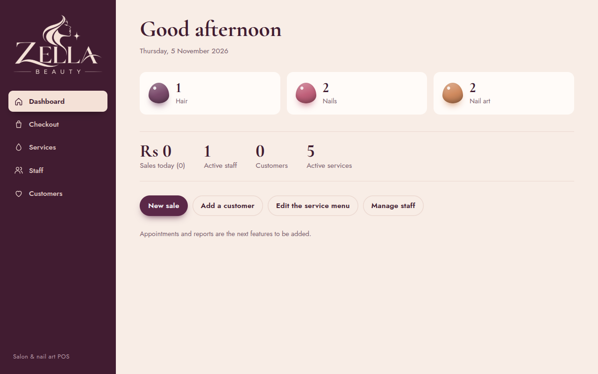
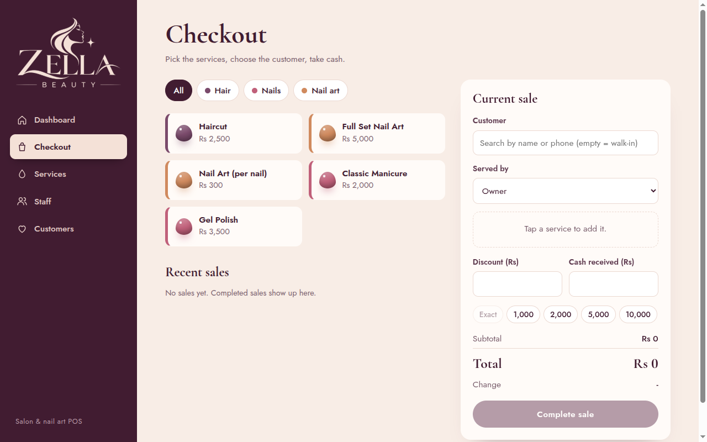
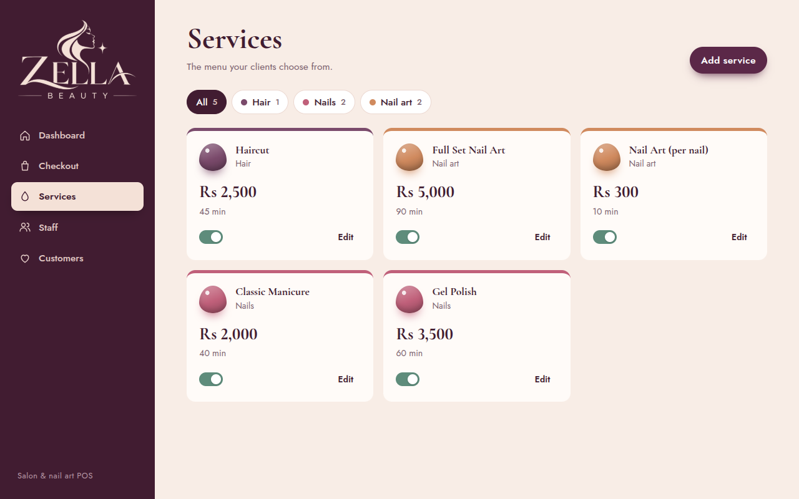

# Zella Beauty POS

A point-of-sale (POS) web application for beauty salons, built with **ASP.NET Core Blazor** on **.NET 8**, styled in the deep plum and soft blush of the Zella Beauty brand.




## Features

- [x] **Checkout** – build a bill from the service menu, pick a customer and stylist, apply a discount, take cash and see the change
- [x] **Services** – manage the service menu with categories (Hair, Nails, Nail art, Skin), prices and durations
- [x] **Staff** – manage stylists and technicians with commission rates
- [x] **Customers** – keep contact details and notes (allergies, favourite colours)
- [x] **Dashboard** – today's sales and a quick overview
- [x] Responsive layout for tablets and phones
- [ ] Appointment tracking
- [ ] Sales reports and commission summaries
- [ ] Authentication and role-based access

## Screenshots

| Checkout | Services |
| -------- | -------- |
|  |  |

## Tech Stack

| Layer     | Technology                                      |
| --------- | ----------------------------------------------- |
| Framework | ASP.NET Core 8 (Blazor Web App, Interactive Server) |
| Language  | C#                                              |
| Database  | SQLite via Entity Framework Core 8              |
| Styling   | Plain CSS, Cormorant Garamond and Jost fonts    |

## Getting Started

### Prerequisites

- [.NET 8 SDK](https://dotnet.microsoft.com/download/dotnet/8.0) or later

### Run locally

```bash
git clone https://github.com/Tharumika/Zella-Beauty-POS.git
cd Zella-Beauty-POS/ZellaBeautyPos.Web
dotnet run
```

The app starts at `http://localhost:5203` (or `https://localhost:7215` with the `https` profile). A local SQLite database (`salon.db`) is created automatically on first run and is not tracked by git.

### Useful commands

```bash
dotnet build ZellaBeautyPos.sln   # Build the solution
dotnet watch                      # Run with hot reload (from ZellaBeautyPos.Web)
```

## Project Structure

```
Zella-Beauty-POS/
├── ZellaBeautyPos.sln
├── docs/screenshots/
└── ZellaBeautyPos.Web/
    ├── Components/
    │   ├── Layout/        # Main layout and sidebar navigation
    │   ├── Pages/         # Dashboard, Checkout, Services, Staff, Customers
    │   └── Shared/        # Modal and toast components
    ├── Data/              # EF Core DbContext and seed data
    ├── Models/            # Service, StaffMember, Customer, Sale, SaleItem
    ├── Services/          # ToastService
    ├── wwwroot/           # Stylesheet, logo and favicon
    └── Program.cs         # Startup and database bootstrap
```

## Roadmap

1. Appointment booking and calendar
2. Sales reports, daily summaries and commission payouts
3. Switch from `EnsureCreated` to EF Core migrations
4. Authentication and roles
5. Receipt printing

## Contributing

Contributions, issues, and feature requests are welcome. Feel free to open an issue or submit a pull request.

## License

No license has been chosen yet. Add a `LICENSE` file to define how this project may be used.
